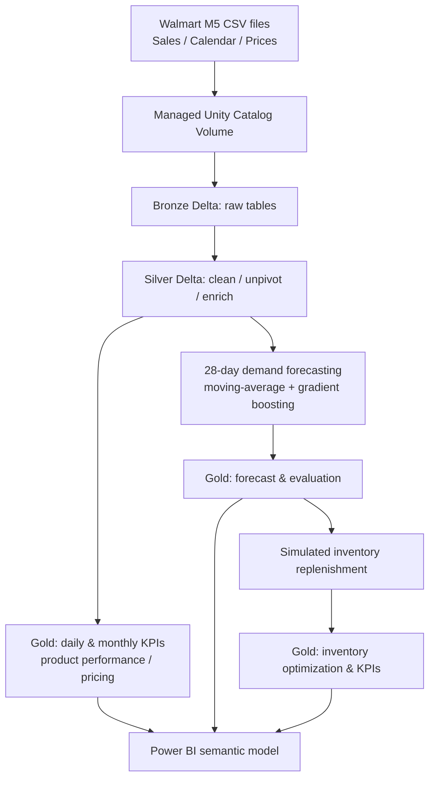
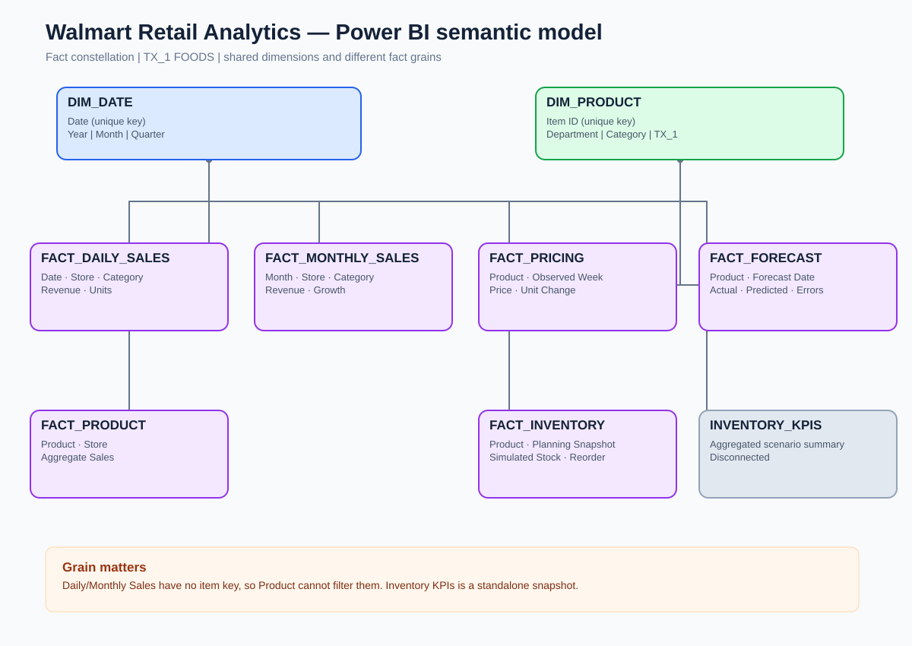
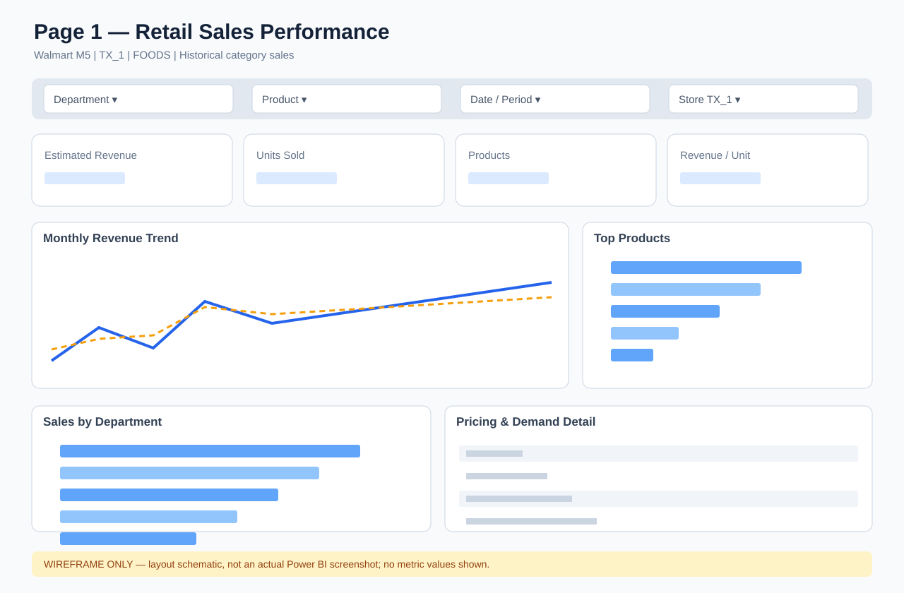
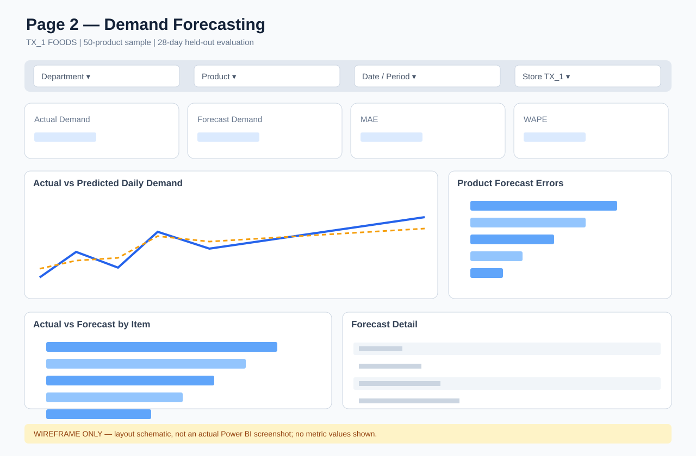
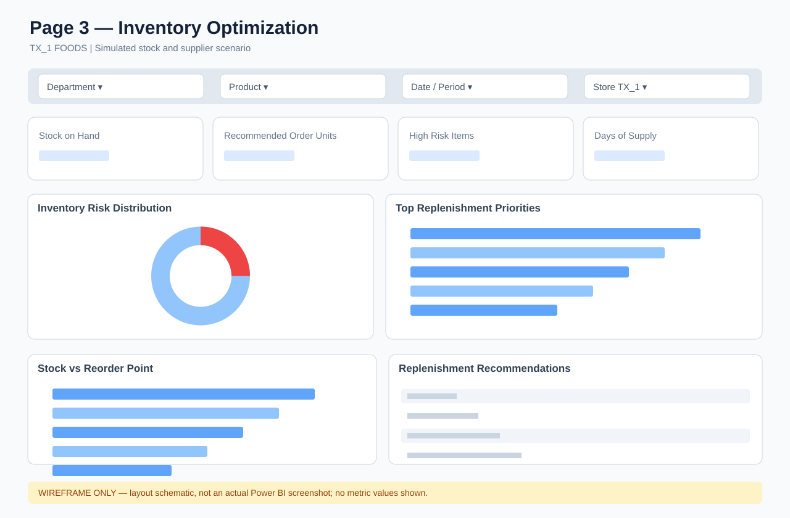

# Walmart Retail Analytics | Databricks • Forecasting • Power BI

**End-to-end retail data pipeline and analytical reporting project** based on the historical [Walmart M5 Forecasting dataset](https://www.kaggle.com/competitions/m5-forecasting-accuracy/data), focused on the **TX_1 store / FOODS category**.

**Tech:** Databricks · PySpark · Spark SQL · Delta Lake · Lakeflow Jobs · Python · scikit-learn · Power BI · DAX

> **Disclosure:** Walmart M5 is historical competition data, not a live retail feed. The inventory, supplier lead times, safety stock, and reorder recommendations are **simulated scenarios**, not actual Walmart operational records. Forecasting began with a 50-product, 28-day prototype. Figures are not claimed until model metrics are published.

## At a glance

| Workstream | Implementation |
| --- | --- |
| Ingestion | M5 sales, price, and calendar CSVs loaded into Unity Catalog volume and Bronze Delta tables |
| Transformation | Silver unpivots daily sales and joins calendars and weekly selling prices |
| Analytics | Gold daily/monthly KPIs, product performance, and pricing analysis |
| Forecasting | 28-day fixed-origin item-level demand forecasts; moving-average baseline vs. gradient-boosting model |
| Evaluation | Holdout actual-vs-predicted demand, MAE, RMSE, WAPE |
| Inventory | Simulated on-hand, incoming stock, lead times, safety stock, reorder points, recommended quantities |
| Orchestration | Five dependent serverless notebook tasks, successful run confirmed in Databricks |
| Business intelligence | Three-page Power BI report |

## Pipeline architecture



### Databricks orchestration

The `walmart_retail_analytics_pipeline` job ran successfully with five sequential tasks:


The original successful-job screenshot is available in the project materials and will be added to `assets/` when uploaded.

## Power BI semantic model



**Model type:** a multi-fact dimensional / fact-constellation model. Date and Product are conformed dimensions **where the fact grain supports them**. The diagram documents the intended Power BI modeling structure; it is **not a screenshot exported from Power BI**.

| Model table | Grain | Relevant dimension |
| --- | --- | --- |
| Daily Sales | Date × store × category | Date |
| Monthly Sales | Month × store × category | Date |
| Product Performance | Item × store | Product |
| Pricing | Item × store × observed week | Date, Product |
| Forecast Evaluation | Item × store × forecast date | Date, Product |
| Inventory | Item × store × forecast-origin snapshot | Product |
| Inventory KPIs | Single aggregated scenario snapshot | Standalone |

**Modeling caveats:** Daily and Monthly Sales are pre-aggregated and have no item key; the Product dimension cannot filter these tables. Inventory KPIs is a standalone summary. No fact-to-fact relationships are required. If adding more stores, use item-store compound keys and an appropriate Store dimension.

## Power BI report

Three pages were identified from the uploaded `WALMART PROJECT.pbix` report definition. The following visuals are **wireframe sketches, not captured dashboard screenshots**.

### Page 1 — Retail Sales Performance


Historical revenue/units, trends, product performance, pricing and slicers.

### Page 2 — Demand Forecasting


Forecast-vs-actual demand, item-level error, and model evaluation.

### Page 3 — Inventory Optimization


Simulated inventory status, reorder recommendations, risk and replenishment.

**Power BI source file:** `WALMART PROJECT.pbix` — add the original file to `powerbi/` after reviewing any embedded connection settings or sensitive metadata. Replace the wireframes with real page screenshots exported from Power BI Desktop when available.

## Key formulas

- Revenue estimate = daily units sold × available weekly selling price
- Forecast horizon = **28 days**, using historical lag/rolling features without including realized sales from the forecast interval
- Inventory position = on hand + on order − backorders
- Reorder point = expected lead-time demand + simulated safety stock
- Replenishment quantity = max(0, target stock − inventory position), subject to reorder trigger
- WAPE = sum(abs(actual − forecast)) / sum(abs(actual)) × 100

Pricing analysis is **descriptive**, not a causal estimate of price elasticity.

## Repository layout

```text
README.md
assets/
  semantic-model.svg
  dashboard-sales-layout.svg
  dashboard-forecast-layout.svg
  dashboard-inventory-layout.svg
  databricks-job-success.png       # add original screenshot
powerbi/
  WALMART PROJECT.pbix             # add original PBIX
notebooks/
  01_bronze_ingestion.py           # export from Databricks
  02_silver_transformations.py
  03_gold_retail_analytics.py
  04_demand_forecasting.py
  05_inventory_optimization.py
```

## Reproduce

1. Download the public M5 CSV files from Kaggle.
2. Create `bronze`, `silver`, and `gold` schemas and a managed volume for the raw files in Databricks.
3. Import the **original notebooks from the working Databricks project** once available, configure the catalog, and execute them in dependency order.
4. Run the Lakeflow Job and verify its output tables.
5. Open the PBIX in Power BI Desktop, review/replace data-source credentials as needed, and refresh its data.
6. Export actual dashboard screenshots for repository previews.

**Not yet in this repository:** raw M5 data, Databricks notebook source exports, the PBIX binary, actual Power BI screenshots, and numeric backtest metrics. They are deliberately not fabricated or represented as already uploaded.

## Skills demonstrated

Medallion architecture · Spark transformations · Delta tables · Data-quality checks · Job orchestration · Time-based model evaluation · Forecasting · Inventory decision support · Dimensional modeling · DAX · Power BI

## License and data

Dataset source: [M5 Forecasting Accuracy competition](https://www.kaggle.com/competitions/m5-forecasting-accuracy/data). The original dataset is not redistributed here. Use the source site's terms for any downloads or reuse.
